<div align="center">


# Start your lead generation company. Tomorrow.

### An agency generated €6,000,000 for its clients.<br>Now it's giving away the whole machine. For free.

<a href="https://cdn.jsdelivr.net/gh/gquthier/leadfactory-os@446719fefc619d8bc3cde749ee89a6954dad723d/docs/media/leadfactory-oss-vsl-en.mp4">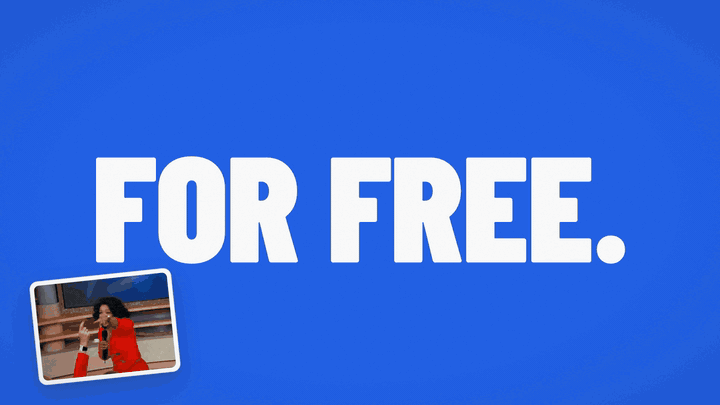</a>

**▶ [Watch the full pitch, with sound (1:45)](https://cdn.jsdelivr.net/gh/gquthier/leadfactory-os@446719fefc619d8bc3cde749ee89a6954dad723d/docs/media/leadfactory-oss-vsl-en.mp4)**

[](#start-tomorrow-its-free)
[](https://github.com/gquthier/leadfactory-os/stargazers)

<br>

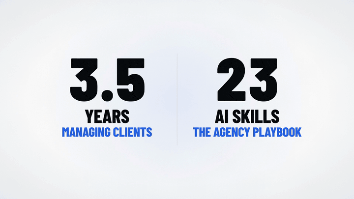

<table>
<tr>
<td align="center" width="25%"><h3>€6M</h3><sub>generated for our clients</sub></td>
<td align="center" width="25%"><h3>3.5 years</h3><sub>running client accounts and a team</sub></td>
<td align="center" width="25%"><h3>7,908 leads</h3><sub>from 21 Meta ad accounts</sub></td>
<td align="center" width="25%"><h3>23 AI skills</h3><sub>ready for your agent to run</sub></td>
</tr>
</table>

No guru. No course. Just what actually worked.

</div>

<br>

<div align="center">

## “Making money has never been easier with AI.”

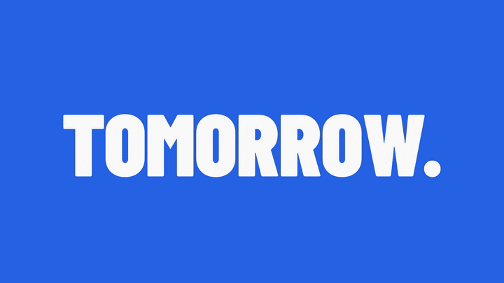

<table>
<tr>
<td width="40%"></td>
<td align="center">Everyone says it.<br>Almost nobody shows you the machine.<br><br><b>This is the machine.</b></td>
</tr>
</table>

</div>

<br>

<div align="center">

## But an agency isn't one job. It's six.

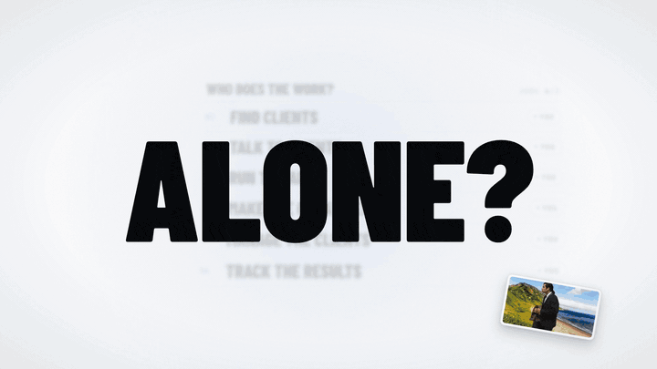

Find clients. Talk to them. Run the ads.<br>
Make the creatives. Manage every client. Track every result.

<table>
<tr>
<td align="center"><b>Alone, it breaks.</b><br>Not because you're not good enough.<br><br>It was never a talent problem.<br><b>It was a team problem.</b></td>
<td width="40%"></td>
</tr>
</table>

</div>

<br>

<div align="center">

## So we cloned the whole agency.

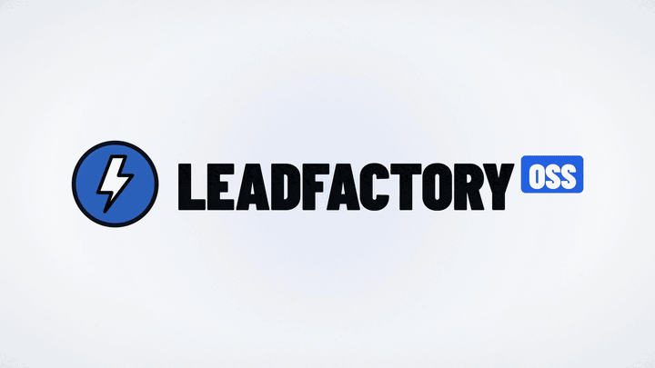

3.5 years of running a real lead gen agency.<br>
Turned into one cockpit and 23 AI skills that your agent runs for you.

<sub>Works with Claude Code, Codex, or any agent that reads a folder.</sub>

</div>

<br>

<div align="center">

## Your new team. Working on day one.

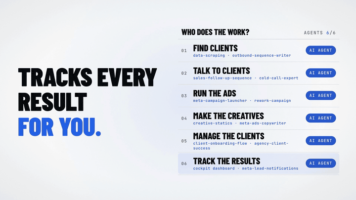

<table>
<tr>
<td align="center" width="33%">🎯<br><b>Finds clients</b><br><sub>Prospect lists, cold emails, call scripts</sub></td>
<td align="center" width="33%">💬<br><b>Talks to your clients</b><br><sub>Follow-ups, sales call breakdowns, check-ins</sub></td>
<td align="center" width="33%">📣<br><b>Runs the ads</b><br><sub>Meta campaigns, ready when you say go</sub></td>
</tr>
<tr>
<td align="center">🎨<br><b>Makes the creatives</b><br><sub>Ad copy, statics, VSL scripts, landing pages</sub></td>
<td align="center">🗂️<br><b>Manages your clients</b><br><sub>Onboarding, tasks, deliverables</sub></td>
<td align="center">📊<br><b>Tracks every result</b><br><sub>One dashboard, every new lead</sub></td>
</tr>
</table>

</div>

<br>

<div align="center">

## Saves you time. Great results for your clients.

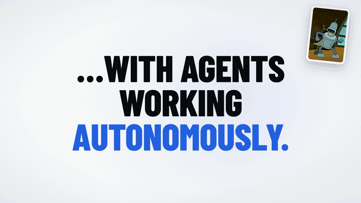

<table>
<tr>
<td width="40%"></td>
<td align="center">Your agents work at every hour.<br><br>You keep the one job nobody can clone:<br><b>signing clients.</b></td>
</tr>
</table>

</div>

<br>

<div align="center">

## Real client work. Made with AI.

<table>
<tr>
<td align="center" width="50%">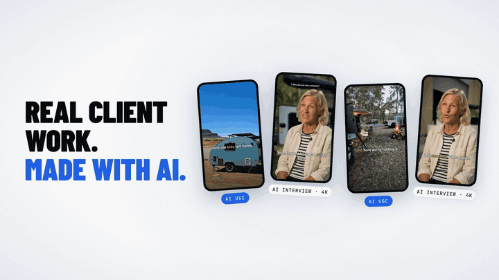<br><b>UGC videos & AI interviews</b></td>
<td align="center" width="50%">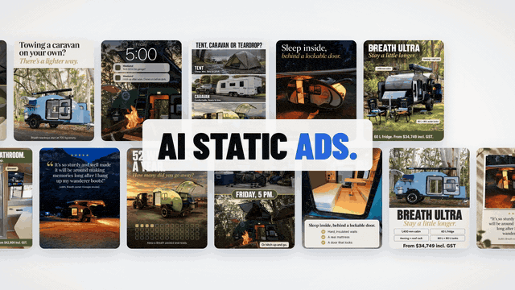<br><b>AI static ads</b></td>
</tr>
</table>

Not mockups. Creatives the agency shipped for real clients.

</div>

<br>

<div align="center">

## Real campaigns. Real leads.

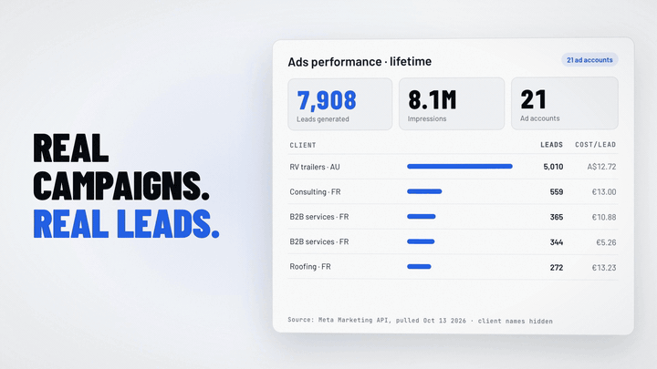

**7,908 leads. 8.1M impressions. 21 Meta ad accounts.**

<sub>Lifetime numbers from the Meta Marketing API, pulled on October 13, 2026. Client names hidden.</sub>

</div>

<br>

<div align="center">

## A clear dashboard. From A to Z.

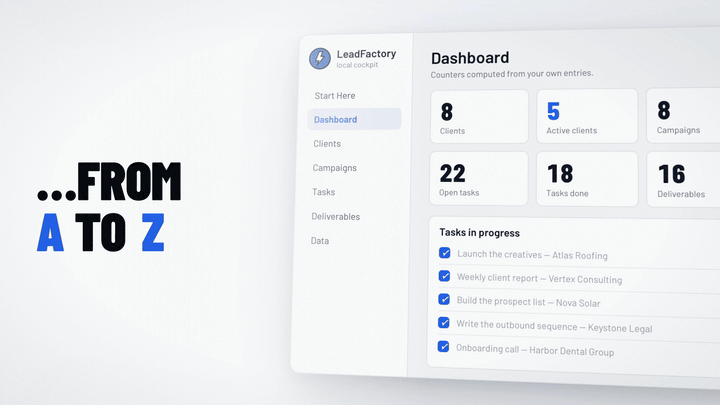

Every client, campaign, task and deliverable. In one place.<br>
**On your own computer.**

</div>

<br>

<div align="center">

## How much?

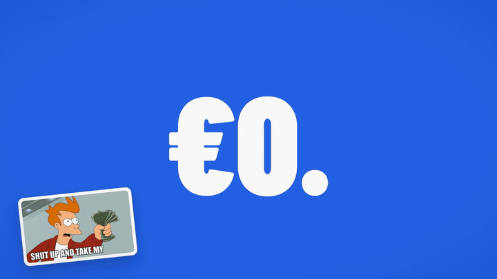

<table>
<tr>
<td align="center">To run an agency, you'd hire:<br><br>🎯 a prospector<br>💬 an account manager<br>📣 a media buyer<br>🎨 a designer and a copywriter<br>📊 an analyst<br><br><b>Here: €0.</b></td>
<td width="45%"></td>
</tr>
</table>

Not a trial. Not “freemium”. Not a webinar with a pitch at the end.<br>
**The software, the 23 skills, the 15 video SOPs and the agency playbook.**

</div>

<br>

<div align="center">

## 100% open source. On GitHub.

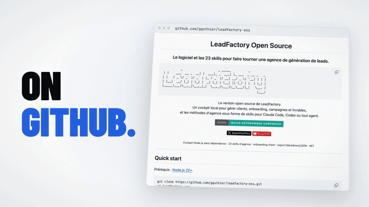

MIT license. Fork it. Rebrand it. Sell the service.<br>
**It's yours.**

</div>

<br>

<div align="center">

## What's the catch?

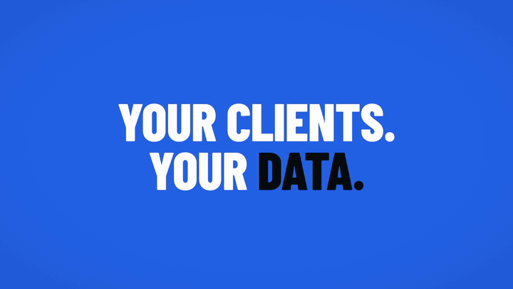

<table>
<tr>
<td width="50%">🖥️ <b>It runs on your computer.</b><br>Your clients, your data. Nothing leaves your machine unless you send it.</td>
<td width="50%">🔌 <b>You bring your own tools.</b><br>Your AI model, your ad accounts, your email tools.</td>
</tr>
<tr>
<td>✋ <b>Nothing goes live without you.</b><br>No email sent, no euro spent, no campaign switched on by itself. Agents prepare. You approve.</td>
<td>🎲 <b>No guaranteed results.</b><br>You get the method of an agency that works. Signing the clients is on you.</td>
</tr>
</table>

</div>

<br>

<div align="center">

## Here's tomorrow morning.

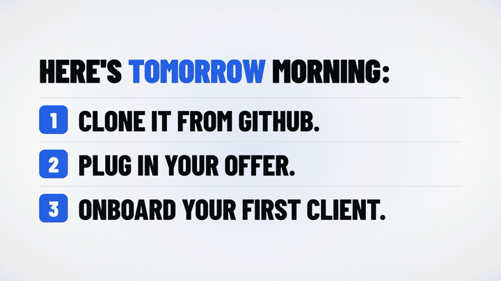

**1.** Clone it from GitHub. &nbsp; **2.** Plug in your offer. &nbsp; **3.** Onboard your first client.

</div>

<br>

<div align="center">

## Is it for you?

<table>
<tr>
<th width="50%">✅ Yes, if…</th>
<th width="50%">❌ No, if…</th>
</tr>
<tr>
<td>You want to start or structure a B2B lead gen agency.</td>
<td>You want software that signs clients while you sleep.</td>
</tr>
<tr>
<td>You're a freelancer who wants to deliver like a team.</td>
<td>You won't review what your agents prepare.</td>
</tr>
<tr>
<td>You already use Claude Code or Codex, or want to start.</td>
<td>You're looking for a guru. There isn't one.</td>
</tr>
</table>

</div>

<br>

<div align="center">

## You have 3 options.

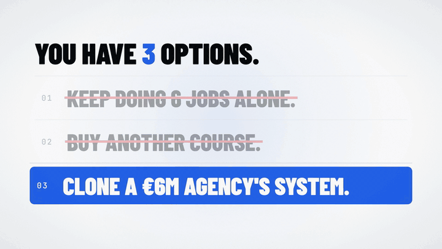

~~1. Keep doing 6 jobs alone.~~<br>
~~2. Buy another course.~~<br>
**3. Clone a €6M agency's system. For free.**

</div>

<br>

<div align="center">

## Start tomorrow. It's free.

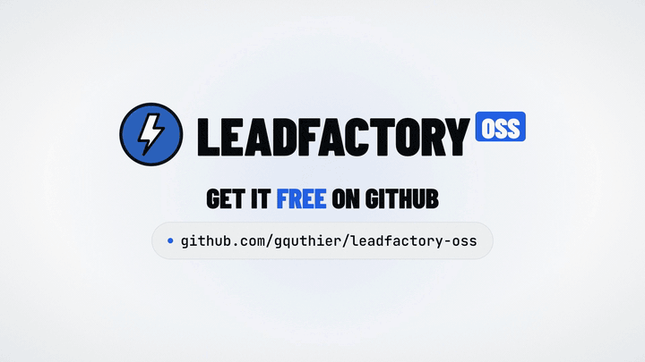

[](docs/INSTALL.md)
[](https://github.com/gquthier/leadfactory-os/stargazers)

```sh
npx --yes --package github:gquthier/leadfactory-os#v0.5.1 leadfactory init my-agency
```

<sub>Node.js 22.12+ and Git · macOS or Linux · one command installs the software, the 23 skills and the 15 video SOPs.</sub>

</div>

---

### Get started

| | |
|---|---|
| 🚀 **[Install guide](docs/INSTALL.md)** | One command, then your first client, in 5 minutes (in French) |
| 🧭 **[Start Here](docs/START-HERE.md)** | Set up your agency and your first client (in French) |
| 🧠 **[The 23 skills](docs/SKILLS.md)** | What each AI skill does (in French) |
| 📘 **[Agency playbook](docs/AGENCY-PLAYBOOK.md)** | The full path, from offer to client reporting (in French) |
| 🎬 **[Video SOPs](docs/SOPS.md)** | 15 step-by-step video tutorials, with subtitles (in French) |
| 🤖 **[For agents](docs/AGENT-START.md)** | Entry point and working rules for your AI agent (in French) |
| 🤝 **[Contributing](CONTRIBUTING.md)** | Issues and pull requests |
| ⚖️ **[License](LICENSE)** | MIT · [third-party notices](THIRD_PARTY_NOTICES.md) |

<sub>21 of the skills are adapted from [tarsluna/my-custom-skills](https://github.com/tarsluna/my-custom-skills) (MIT). The software was rewritten, and no LeadFactory client data is redistributed. In the video, client names are hidden and the creatives shown are real agency work.</sub>

---

<div align="center">

### Building something that runs on its own?

[](https://bizos.cc)

[](https://x.com/gauthierthiry)
[](https://youtube.com/@gquthier)

</div>
